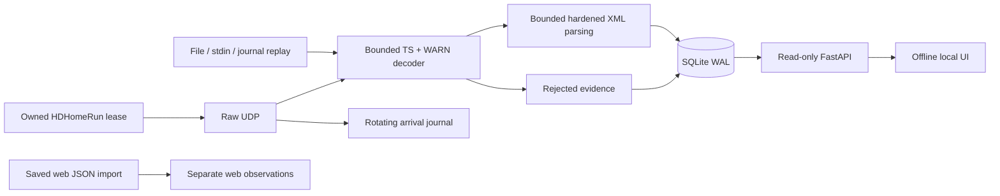

# Architecture and implementation plan

Implemented sequence: independent golden vectors and transport decoder; file/stdin
and deterministic replay; SQLite evidence store; raw UDP/journaling and controlled
tuner adapter; read-only API/offline UI; container/CI and operational documentation.
This is a modular single application with no cloud dependency in the receive path.

`transport/` depends only on Python's standard library; XML and server can be
omitted when using the decoder as a library. `formats/` owns dispatch and preserved
trees. `inputs/` owns acquisition and replay. `pipeline.py` handles classification,
summary counters and persistence. `storage/001_initial.sql` is the explicit initial
migration, followed by 002_receiver_status.sql for persisted RF samples and
003_recoveries.sql for auditable reinterpretation of rejected observations; newer unknown database versions are refused by writers. `domain/` projects readable CAP fields, declared lifecycle and derived geometry
from preserved trees without writing evidence. `api/` has no receiver startup hook
or mutation routes. `web/` contains all necessary UI assets.

Each accepted observation stores raw TS bytes, stream offsets, assembled bytes,
header/body, CRCs, transport ID, reception metadata, session and processing time.
Content and protocol identities are distinct. Rejections are bounded independently
(default newest 1000); counters survive pruning in receiver sessions. Health events
retain the newest 1000. Accepted evidence is not automatically deleted. At a 512 MiB
database-plus-WAL threshold ingestion stops for archival; in-flight cleanup can
overshoot by a bounded pending batch. SQLite page reuse can leave file size at its
high-water mark. Optional raw journals keep eight 8 MiB segments (base64 overhead included).
Live input discards unrelated packets and creates no raw journal by default; only
WARN packet/message evidence enters SQLite. Message JSONL is flushed during reception.
Disk-full failures can prevent final diagnostics; no software can promise durable
writes after filesystem failure.

A per-database POSIX flock allows only one ingestion worker, including imports.
SQLite WAL permits API readers; each request opens a read-only connection. Sessions
left running after an unclean crash are marked abandoned on the next exclusive
writer acquisition. Legacy API detail embeds at most 100 observations; paginated /api/v1/deliveries
provides full accepted delivery history; raw parts select
an observation belonging to the requested content ID, never a caller's path.

No telemetry exporter, URL retrieval from XML, public-warning publisher, siren
control, IPAWS origination, or online polling exists. Saved web JSON imports are
size-limited (2 MiB), retained separately (100 latest), labeled not comparable, and
do not create OTA messages or affect RF health.

Native discovery, device metadata, automatic idle tuner leases and WSL return routing
are documented in [live-receiver.md](live-receiver.md). HTTP serving still starts no
receiver; tuner operations remain CLI-only.

Owned HDHomeRun reception now sends native UDP video keepalives from the same bound
receiving socket to device port 5004. The receive-loop clock schedules them during
idle periods; failures propagate through existing source/lease cleanup. No extra
worker or raw recording is introduced.

RF control reads run in a dedicated worker with a bounded latest-sample queue.
The ingestion thread persists snapshots; the API reads them and computes freshness
without device access. See ui-monitoring.md for threading, freshness and source-aware
archive/delivery presentation.

The alert inbox defaults to the live source group and excludes heartbeat/Link Tests.
Non-Link-Test CMAC is included even when its status/enum is unknown, so unrecognized
alert content is available for review. The heartbeat indicator uses a separate
live-only timed observation query; replay, file-import clocks and XML sent times
cannot refresh it. All message resources stay local and inert, including web links.

Alert coordinates are rendered by locally vendored Leaflet, with local Natural
Earth GeoJSON for default reference geography. The map lifecycle is scoped to the
active information block and disposed on close/source/language changes. Optional
OpenStreetMap tiles are browser image requests only after explicit selection; they
do not involve the receiver, ingestion process or a server proxy. See maps.md for
licensing and reproducible source manifests.

The Linux live Docker stack runs receiver and web as separate non-root processes
on host networking, sharing only the archive volume and read-only configuration.
The web socket binds an explicit LAN address and optional web_allowed_networks
restricts all HTTP routes by actual client peer. Uvicorn proxy-header trust is
disabled. No public ports, new reverse proxy or automatic firewall changes are
introduced. See docker-live.md for routing, persistence and safe startup.

The operator deployment is image-only: compose.deploy.yaml is downloaded as the
host's /opt/warnbridge/compose.yaml and pulls ghcr.io/bho18/warnbridge:edge. The host needs no Git
checkout or build environment. The publishing workflow validates the source branch
before releasing images; operator pull/up updates retain the local TOML and named
archive. compose.live.yaml is the source-build developer alternative, while the
repository's compose.yaml is the replay demo. Current install/update instructions
are centralized in docker-live.md and the deployment contract in AGENTS.md.

## Header recovery and lifecycle display

At exclusive writer startup, eligible retained complete-message failures are replayed
through the corrected decoder. Only one successfully decoded message with identical
assembled bytes and transport ID can be promoted. Its observation ID, session/source,
reception/processing clocks, raw TS, assembled bytes and offsets stay unchanged.
`observation_recoveries` retains the prior reason, header/body interpretation and CRC
fields, plus recovery time. Historical session counters remain historical; a separate
recovered count and startup health event report corrections. A second startup does
not create duplicate deliveries. Packet-loss/timeout fragments are never stitched.
The read-only API does not perform recovery or start capture.

The alert inbox includes unknown and malformed content for inspection, excluding only
heartbeat/Link Tests and proper CAP Cancel cards. Cancel records remain available in
cancellation history and the diagnostic archive. Referenced alert details include
cancellation info blocks, text, instructions and links to full original evidence.
A new Alert containing all-clear language remains independent; text never drives
reference lifecycle. Cancellation and identity conflict checks stay source-scoped.
An unmatched cancellation remains in history until its target arrives.

XML text previews and CLI JSONL respect XML encoding; raw downloads are unchanged.
Undecodable content has a hexadecimal preview. Unknown encodings cannot crash ingestion.
Storage usage and the configured archive stop threshold are visible through health/UI.

## Receive-to-display limit audit

- UDP accepts raw TS datagrams up to the IPv4 UDP receive buffer size and checks the
  configured receiver source. RTP/non-TS datagrams remain explicit diagnostics; the
  app does not silently parse them as raw TS. No geographic or alert-text filter runs.
- TS checks reject broken fragment sequence/continuity, transport errors, conflicting
  assemblies, mismatched IDs, bad CRC and non-FF stuffing. Correct messages after a
  rejected assembly still proceed. The supplied header variants and full two-byte
  body length are covered by regression tests.
- Configurable defaults are 1 MiB body, 8192 fragments, 16 simultaneous assemblies
  and 30-second incomplete-assembly timeout. The body limit applies to the actual
  two-byte length, not unrelated header fields. These are resource bounds, not a
  whitelist of alerts. Timeout/sequence failures retain their evidence.
- XML parsing retains invalid/unknown documents as inspectable messages. DTD/entity
  expansion remains disabled; depth 64 and 10,000-element bounds protect the parser.
  Unsupported encodings now produce a visible parse failure instead of terminating
  ingestion. Missing schema/signature configuration never gates acceptance/display.
- The inbox shows all non-heartbeat/non-Link-Test contents, including new statuses,
  unknown roots and malformed XML. Proper Cancel has separate history and attaches
  to its target; all-clear wording never hides a new Alert. Source/status selectors
  and pagination remain explicit presentation choices.
- The default 512 MiB database+WAL stop threshold remains configurable; 80% and full
  usage now show a UI warning, and quota stops have a specific health event. Rejected
  retention remains newest 1000; accepted data is not silently pruned. Physical disk
  exhaustion and unobserved protocol variants remain operational limitations.
