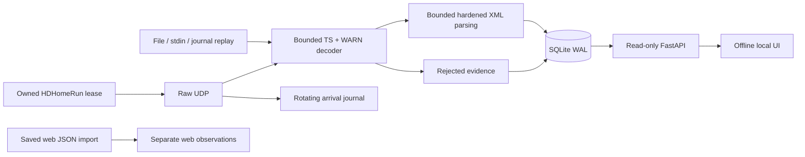

# Architecture and implementation plan

Implemented sequence: independent golden vectors and transport decoder; file/stdin
and deterministic replay; SQLite evidence store; raw UDP/journaling and controlled
tuner adapter; read-only API/offline UI; container/CI and operational documentation.
This is a modular single application with no cloud dependency in the receive path.

`transport/` depends only on Python's standard library; XML and server can be
omitted when using the decoder as a library. `formats/` owns dispatch and preserved
trees. `inputs/` owns acquisition and replay. `pipeline.py` handles classification,
summary counters and persistence. `storage/001_initial.sql` is the explicit initial
migration, followed by 002_receiver_status.sql for persisted RF samples; newer unknown database versions are refused by writers. `domain/` projects readable CAP fields, declared lifecycle and derived geometry
from preserved trees without writing evidence. `api/` has no receiver startup hook
or mutation routes. `web/` contains all necessary UI assets.

Each accepted observation stores raw TS bytes, stream offsets, assembled bytes,
header/body, CRCs, transport ID, reception metadata, session and processing time.
Content and protocol identities are distinct. Rejections are bounded independently
(default newest 1000); counters survive pruning in receiver sessions. Health events
retain the newest 1000. Accepted evidence is not automatically deleted. At a 512 MiB
database-plus-WAL threshold ingestion stops for archival; in-flight cleanup can
overshoot by a bounded pending batch. SQLite page reuse can leave file size at its
high-water mark. Optional raw journals keep eight 8 MiB segments (base64 overhead included).
Live input discards unrelated packets and creates no raw journal by default; only
WARN packet/message evidence enters SQLite. Message JSONL is flushed during reception.
Disk-full failures can prevent final diagnostics; no software can promise durable
writes after filesystem failure.

A per-database POSIX flock allows only one ingestion worker, including imports.
SQLite WAL permits API readers; each request opens a read-only connection. Sessions
left running after an unclean crash are marked abandoned on the next exclusive
writer acquisition. Legacy API detail embeds at most 100 observations; paginated /api/v1/deliveries
provides full accepted delivery history; raw parts select
an observation belonging to the requested content ID, never a caller's path.

No telemetry exporter, URL retrieval from XML, public-warning publisher, siren
control, IPAWS origination, or online polling exists. Saved web JSON imports are
size-limited (2 MiB), retained separately (100 latest), labeled not comparable, and
do not create OTA messages or affect RF health.

Native discovery, device metadata, automatic idle tuner leases and WSL return routing
are documented in [live-receiver.md](live-receiver.md). HTTP serving still starts no
receiver; tuner operations remain CLI-only.

Owned HDHomeRun reception now sends native UDP video keepalives from the same bound
receiving socket to device port 5004. The receive-loop clock schedules them during
idle periods; failures propagate through existing source/lease cleanup. No extra
worker or raw recording is introduced.

RF control reads run in a dedicated worker with a bounded latest-sample queue.
The ingestion thread persists snapshots; the API reads them and computes freshness
without device access. See ui-monitoring.md for threading, freshness and source-aware
archive/delivery presentation.

The alert inbox defaults to the live source group and excludes heartbeat/Link Tests.
Non-Link-Test CMAC is included even when its status/enum is unknown, so unrecognized
alert content is available for review. The heartbeat indicator uses a separate
live-only timed observation query; replay, file-import clocks and XML sent times
cannot refresh it. All message resources stay local and inert, including web links.
